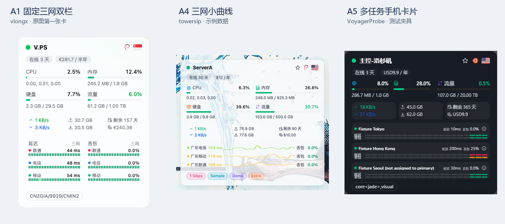

# Glassmorphism 衍生项目优化候选：2026-10-12

当前结论：优先融合小范围的手机适配、任务元数据缓存、图表显示正确性与安全修复；首页三网布局由用户选择。所有编号都是候选，尚未合入 fork 功能。Issue #59 与用户截图中的负载图图例问题是独立的本地修复。

## 审查范围与证据边界

- 本地主线：`e0aedb0`，主题 manifest 版本 `3.3.8`。
- GitHub 原仓库直接 fork 清单 53 个；独立同名项目 5 个；额外追溯出 1 个已更名的衍生项目 Transit，共 59 个源码快照。
- 搜索同时使用原仓库 forks API、`komari Glassmorphism in:name fork:false`、`Glassmorphism in:name fork:false language:Vue` 和 GitHub 网页搜索，覆盖断开 fork 关系的项目。搜索范围不代表所有衍生仓库已穷尽。
- 58 个同名 / fork 候选中，29 个没有本地主线之外的提交；另 29 个具有独有提交。独有提交数量包含文档、发行、合并历史，不是有效优化数量。
- 先筛选独有提交，再对主要候选用 `git diff HEAD <source-ref> -- <paths>` 检查当前源码差异，避免把主线已具备的能力重复合入。
- 下列收益是源码审查结论，没有在同一台手机上对各 fork 做性能基准，也没有执行它们的构建或安装脚本。截图来自源码仓库已有图片 / 测试基线，并非本轮运行这些 fork 得到的结果。
- 59 个快照均发现 MIT LICENSE；采用代码时保留适用的原作者及二开作者版权声明。Transit 还声明 `Copyright (c) 2026 yyy622hhh`。
- GitHub 公开 API / Git 读取结果与源码 SHA 已归档于本地 `tmp/fork-audit-20261012/`。本次没有修改远端仓库、版本或发布状态。

## 首页三网 / 多任务卡片：A 系列

这些布局是不同选择；A1–A5 不建议一次性叠加成五套常驻界面。可以选一种主布局，再吸收其他项目的任务绑定、触屏交互和请求优化。

| 编号 | 方案和来源                                                                                                                                                                                                                                    | 具体展示                                                                                                                                   | 建议及兼容边界                                                                                                                                                                 |
| ---- | --------------------------------------------------------------------------------------------------------------------------------------------------------------------------------------------------------------------------------------------- | ------------------------------------------------------------------------------------------------------------------------------------------ | ------------------------------------------------------------------------------------------------------------------------------------------------------------------------------ |
| A1   | 固定三网双栏：[vlongx](https://github.com/vlongx/komari-theme-Glassmorphism-three-network)、[kk66615](https://github.com/kk66615/komari-theme-Glassmorphism-three-network)、[JudiLite](https://github.com/JudiLite/Komari-Glassmorphism-Lite) | 保留延迟 / 丢包左右两块，每块固定联通、电信、移动三行，数字与采样色条对应。kk66615 提供默认关闭的开关。                                    | **适合只关注国内三网，改动较小。** 名称识别会把多个同运营商任务聚合，未必代表指定地区 / 指定线路；建议配合 F1 的明确任务 ID 绑定。无数据不能显示为 0ms / 0%。                  |
| A2   | 通用任务行：[thinkemm](https://github.com/thinkemm/komari-theme-Glassmorphism)、[LuxJon](https://github.com/LuxJon/komari-theme-Glassmorphism-ThreeNetwork)、[Lusyne](https://github.com/Lusyne/komari-theme-Glassmorphism)                   | 每个任务分别展示名称、延迟、丢包和小色条。thinkemm 把每任务延迟 / 丢包配在同一行；LuxJon 保留两列；Lusyne 将名称、色条、数值压在同一横行。 | **默认推荐 thinkemm 思路。** 不限制必须是三网，兼容中转 / TCP 等其他探测任务。建议显示上限可配置，溢出到详情，保持后台任务顺序。不能把当前延迟与历史平均丢包混写为同一采样点。 |
| A3   | 固定高度四线路：[Fourgetu](https://github.com/Fourgetu/komari-theme-Glassmorphism)                                                                                                                                                            | Ping 区域固定 96px，最多 4 行；每行名称、延迟、丢包三列，数值下方放微型色条。                                                              | **节点很多、重视卡片整齐时推荐。** 字号和单行高度较小，手机点击目标与长名称可读性需要加强；超过四个任务的处理要明确。                                                          |
| A4   | 三网小曲线：[towersip](https://github.com/towersip/komari-theme-Glassmorphism)                                                                                                                                                                | 每条任务一条 sparkline，左侧名称和延迟，右侧丢包；可悬停 / 触摸检查某段历史。支持按服务器绑定。                                            | **外观与趋势阅读优先时推荐，作为可选样式。** 窄卡需要更短名称或上下排版；曲线必须保留缺测断点，不能用平滑填补真实故障。小曲线不是新的探测数据来源。                            |
| A5   | 可配置 1 / 2 / 3 任务块：[VoyagerProbe / Glassmorphism-Plus](https://github.com/VoyagerProbe/Glassmorphism-Plus)                                                                                                                              | 每任务名称 + 独立延迟 / 丢包色条；全局默认和每节点覆盖；明确区分未配置、任务失效、暂无采样、更新失败。                                     | **任务绑定需求复杂时推荐，移植成本较高。** 建议只移植展示 / 配置模型与必要服务，复用主线请求、缓存和权限边界；不整体导入其庞大调度器、路由和 Worker。                          |
| A6   | 三网中转估算：[casiuna / Glassmorphism-Enhanced](https://github.com/casiuna/Glassmorphism-Enhanced)                                                                                                                                           | 用中转节点的三网探测加节点间链路延迟，推导落地节点三网估算；支持配套地球弧线。                                                             | **暂缓。** 延迟相加及丢包概率合成依赖采样时间、探测方向、路径与独立性假设，不能标成端到端实测。若需要，应作为清晰标注的独立可选估算。                                          |
| A7   | 按节点用途选择观测面板：[yyy622hhh / Transit](https://github.com/yyy622hhh/komari-theme-transit)                                                                                                                                              | 每节点选择三网、自定义 Ping、系统、流量、存储、GPU、精简信息或自动模式。                                                                   | **后续功能版本考虑。** 更灵活但已超出“只加三网小卡”的范围；优先借用 M6 的卡片宽度响应式方案。Transit 自定义任务匹配使用名称，融合时建议统一到任务 ID。                         |

三张源码仓库中的实际展示例子：

来源原图：[A1](fork-review-20261012/vlongx.png)、[A4](fork-review-20261012/towersip-light.png)、[A5](fork-review-20261012/voyager-mobile.png)。A4 和 A5 使用仓库示例 / 测试数据，数值不用于比较网络质量；上图裁剪并缩放，不能据此比较原始字体物理尺寸。

关键代码定位：

- A1：[kk66615 14268da](https://github.com/kk66615/komari-theme-Glassmorphism-three-network/commit/14268da)，`useNodeCarrierPingStats.ts`、`NodeCard.vue`；可选开关 [37c91b4](https://github.com/kk66615/komari-theme-Glassmorphism-three-network/commit/37c91b4)。
- A2：[thinkemm ac3ca66](https://github.com/thinkemm/komari-theme-Glassmorphism/commit/ac3ca66)、[bf67ad5](https://github.com/thinkemm/komari-theme-Glassmorphism/commit/bf67ad5)，`useNodePingDisplay.ts` / `useNodePingStats.ts` / `NodeCard.vue`；LuxJon `NodeMultiPingStatus.vue`；Lusyne `NodeCard.vue`。
- A3：[Fourgetu bcc8851](https://github.com/Fourgetu/komari-theme-Glassmorphism/commit/bcc8851)，`visiblePingTasks.slice(0, 4)`、固定 `h-24`。
- A4：[towersip 3e519a0](https://github.com/towersip/komari-theme-Glassmorphism/commit/3e519a0)、[d24b963](https://github.com/towersip/komari-theme-Glassmorphism/commit/d24b963)，`useThreeNetPing.ts`、`useSparklinePeriodInspect.ts`、`NodeCard.vue`。
- A5：Plus `NodeCardPingGroup.vue`、`NodeCardPingTaskStrip.vue`、`nodeCardMultiPingConfig.ts`；该配置明确为 1 / 2 / 3 项。
- A6：Enhanced `carrierPing.ts`、`transitCarrierPing.ts`、`earthArcs.ts`。
- A7：Transit `NodeCardInsightPanel.vue`、`nodeCardPanel.ts`、`node-card-panel.service.ts`。

## 手机浏览器：M 系列

| 编号 | 来源及候选                                                                                                                                       | 可见收益                                                                                             | 我的建议                                                                                                                                                                                       |
| ---- | ------------------------------------------------------------------------------------------------------------------------------------------------ | ---------------------------------------------------------------------------------------------------- | ---------------------------------------------------------------------------------------------------------------------------------------------------------------------------------------------- |
| M1   | [towersip](https://github.com/towersip/komari-theme-Glassmorphism)、[Plus](https://github.com/VoyagerProbe/Glassmorphism-Plus)：安全区与弹窗边界 | 刘海屏、横屏、添加到主屏幕时，页头 / 页脚 / 返回顶部按钮 / 弹窗避开系统区域。                        | **优先。** 主线弹窗已经使用 `100dvh`，缺的是统一安全区计算。先移植 CSS inset 部分；页面缩放补偿和替换 DialogOverlay 的做法须单独验证，不能顺带复制。                                           |
| M2   | [Plus](https://github.com/VoyagerProbe/Glassmorphism-Plus)：详情页标题及切换器重排                                                               | 长节点名、状态、厂商、标签与节点切换器在窄屏不再挤成一行；标题栏按钮不会挤压站点名。                 | **优先。** 只移植网格和截断策略，保留主线已修复 Issue #56 的主题 Select；不要退回 fork 里的原生 select，也不增加一排无关按钮。                                                                 |
| M3   | [Plus](https://github.com/VoyagerProbe/Glassmorphism-Plus)、[towersip](https://github.com/towersip/komari-theme-Glassmorphism)：触屏浮窗手势     | 区分轻点、拖动滚动、长按选择和双指手势；触摸后模拟鼠标事件不会误关或重开浮窗；旋转及卸载清理监听器。 | **优先。** Plus 的 `usePingTooltipTouch.ts` 有专门逻辑。与 Issue #59 的共享 Tooltip 层级修复是两件事，不能用触屏逻辑替代层级修复。需要 Chromium 触控 + WebKit 回归，实体 Safari 仍需实机确认。 |
| M4   | [towersip](https://github.com/towersip/komari-theme-Glassmorphism)：横竖屏背景与稳定选图                                                         | 手机可配竖图，桌面可配横图；多张地址在会话内固定选择，减少浏览器工具栏尺寸变化引起的背景重新加载。   | **可选。** 该 fork 最终实现按首次视口方向固定，实际旋转并不会自动换图；应决定“旋转切换”还是“会话稳定”。其撤回 `background-attachment: fixed` 的修复与主线当前背景 CSS 相同，无需重复移植。     |
| M5   | [pwremilk](https://github.com/pwremilk/komari-theme-Glassmorphism-custom)：无 WebGL 时地图降级                                                   | 某些手机浏览器 / 禁用硬件加速时显示平铺地图，避免地球空白。                                          | **优先。** 在主线已有懒加载组件选择处降级即可。fork 只检测 WebGL1；建议核对具体渲染器要求，并覆盖创建失败 / context lost，不仅检查一次布尔值。                                                 |
| M6   | [Transit](https://github.com/yyy622hhh/komari-theme-transit)：按卡片宽度响应                                                                     | 窄卡把三网区独占一行，关键流量数字可换行，长名称最多两行，桌面多列小卡也能适应。                     | **推荐结合所选 A 方案融合。** 借用 `TransitNodeCard.vue` 的 container query 思路，不换其整套卡片皮肤。折线 / 色条区域应设可读最小宽度。                                                        |
| M7   | [LuxJon](https://github.com/LuxJon/komari-theme-Glassmorphism-ThreeNetwork)：分层筛选栏与地区筛选                                                | 分组 / 快捷筛选与国家地区分层，手机横向滑动，减少工具条互相挤压。                                    | **可选。** 主线已有横向滚动与快捷筛选，真正新增的是独立地区筛选及布局层次。不要只复制滚动 class 并声称新性能优化。                                                                             |

证据：towersip [48d9587](https://github.com/towersip/komari-theme-Glassmorphism/commit/48d9587)、[7003fdf](https://github.com/towersip/komari-theme-Glassmorphism/commit/7003fdf)、[4d7ed49](https://github.com/towersip/komari-theme-Glassmorphism/commit/4d7ed49)、[b11a46c](https://github.com/towersip/komari-theme-Glassmorphism/commit/b11a46c)；pwremilk [ca5bfb0](https://github.com/pwremilk/komari-theme-Glassmorphism-custom/commit/ca5bfb0)；Plus `InstanceDetail.vue` / `AppDialog.vue` / `usePingTooltipTouch.ts`；LuxJon [9b176c7](https://github.com/LuxJon/komari-theme-Glassmorphism-ThreeNetwork/commit/9b176c7)。

## 性能与资源使用：P 系列

| 编号 | 候选与来源                                                                                                                                     | 与主线相比的增量                                                                                                    | 建议与限制                                                                                                                                                                                  |
| ---- | ---------------------------------------------------------------------------------------------------------------------------------------------- | ------------------------------------------------------------------------------------------------------------------- | ------------------------------------------------------------------------------------------------------------------------------------------------------------------------------------------- |
| P1   | [thinkemm](https://github.com/thinkemm/komari-theme-Glassmorphism)：公开 Ping 任务短期缓存、完整取消关联任务请求                               | 主线 `loadPublicPingTasks()` 仅在途去重，没有同样的已完成结果 TTL 缓存；`abortPingRecords()` 未取消 `:tasks` 分支。 | **优先，小范围。** 复用 SharedCache / RequestManager。缓存要有后台保存、任务改名 / 删除后的失效入口，不能无期限显示旧绑定。`:tasks` 中止补齐属于选用记录+任务路径后的生命周期完整性。       |
| P2   | [Plus](https://github.com/VoyagerProbe/Glassmorphism-Plus)：共享刷新调度、后台暂停、按任务周期刷新                                             | 主线已经按节点共享查询并在离开首页时释放，但仍给每个共享条目设置定时器，没有同等可见性 / 离线暂停逻辑。             | **推荐分阶段。** 先补隐藏页暂停与回前台刷新，再评估统一定时器及退避。不得暂停节点 WebSocket 实时更新或造成回前台长期不刷新。                                                                |
| P3   | [Plus](https://github.com/VoyagerProbe/Glassmorphism-Plus)、[Transit](https://github.com/yyy622hhh/komari-theme-transit)：多节点批量 Ping 请求 | 将同一时间窗的多个节点 / 任务请求按上限分块，通过 `entity_ids` 查询并分发，减少大量卡片的重复开销。                 | **节点较多时收益更有希望，成本中高。** 保留旧后端逐节点回退和现有并发上限，避免把 1 个请求变成无边界的大响应。需要以 10 / 50 / 100 节点的请求数、体积和首屏时间验证，不给未经测量的百分比。 |
| P4   | [pwremilk](https://github.com/pwremilk/komari-theme-Glassmorphism-custom)：统一玻璃透明度 / 模糊强度                                           | 把各玻璃表面的 blur 与 alpha 统一到配置变量，可主动降低手机合成负担。                                               | **可选，视觉取舍。** 保留当前外观为默认，提供低模糊档；不能直接整体复制其黑白皮肤并称为纯性能优化。                                                                                         |

定位：P1 `metrics.service.ts`、`history.service.ts`；P2 Plus `ping-refresh-scheduler.service.ts`；P3 Plus `node-card-ping-coordinator.service.ts` / `metrics.service.ts`，Transit `ping-metric-batch.service.ts`；P4 pwremilk [f826ecd](https://github.com/pwremilk/komari-theme-Glassmorphism-custom/commit/f826ecd)。

## 正确性与安全：Q 系列

| 编号 | 来源与候选                                                                                                                                                                            | 问题和收益                                                                                                                  | 建议                                                                                                                                             |
| ---- | ------------------------------------------------------------------------------------------------------------------------------------------------------------------------------------- | --------------------------------------------------------------------------------------------------------------------------- | ------------------------------------------------------------------------------------------------------------------------------------------------ |
| Q1   | [Plus](https://github.com/VoyagerProbe/Glassmorphism-Plus)：保留断点的显示平滑、同名任务区分、浮窗文本转义                                                                            | 主线 PingChart 开启平滑时仍插值空值，可能把缺测连起来；以名称匹配图例 / 颜色会混淆同名任务；任务名直接拼入 HTML formatter。 | **优先。** 原数据、时间戳与统计不变；只平滑展示值，遇空值重置；标签加任务 ID；外部名称转义。应同步检查通用指标图浮窗中的任务 / GPU 名称。        |
| Q2   | [3560912451zz-stack](https://github.com/3560912451zz-stack/komari-theme-Glassmorphism)、[Enhanced](https://github.com/casiuna/Glassmorphism-Enhanced)：地理结果与地址校验 / IPv6 回退 | 拒绝内网、回环和保留地址的第三方查询；拒绝供应商未知值 `(0,0)`；IPv4 定位失败时尝试 IPv6；切换节点后忽略旧查询结果。        | **推荐。** 需要补标准化 IPv6 / mapped IPv4 边界，不原样复制不完整的正则；保留现有权限检查、供应商退避与国家坐标回退，不增加其定制城市翻译 API。  |
| Q3   | [aisa-barry](https://github.com/aisa-barry/komari-theme-Glassmorphism)：周期流量的分指标聚合                                                                                          | 主线已有累计流量 `net.total.up/down: last`；候选额外给 `traffic.up/down` 指定 `sum`。                                       | **核对后端定义后再决定。** 若该指标是每桶增量应求和；若是周期累计 gauge 应取 last。不能只根据字段名称盲目相加，否则重复计数。                    |
| Q4   | [Plus](https://github.com/VoyagerProbe/Glassmorphism-Plus)：长时间窗粗细历史合并                                                                                                      | 检测 Metric Store 返回的采样层级，保留整段长历史，有限次补查近期更细片段。                                                  | **可选。** 解决长范围被近期数据取代的问题；其实现最多补查 3 次，不是简单“加载更快”，会增加部分请求。必须核对保留时间和边界，不能用补点制造历史。 |
| Q5   | [Transit](https://github.com/yyy622hhh/komari-theme-transit)：区分 ICMP 丢包与 TCP/HTTP 连接失败、标注多节点共同失败                                                                  | 避免将端口拒绝 / 公共目标限流误判为每台节点网络都坏了；保留原始失败数据。                                                   | **可选。** 协议名称区分值得先做；共同失败识别依赖足够完整的多节点同时间桶数据，只标注迹象，不自动隐藏丢包或断言目标一定故障。                    |

证据：Plus `pingChartPresentation.ts` / `pingChartSmoothing.ts` / `pingMetricCoverage.service.ts`；地理校验 [862b89e](https://github.com/3560912451zz-stack/komari-theme-Glassmorphism/commit/862b89e)、[d54fe3b](https://github.com/3560912451zz-stack/komari-theme-Glassmorphism/commit/d54fe3b)、[d5084a3](https://github.com/3560912451zz-stack/komari-theme-Glassmorphism/commit/d5084a3)；Transit `pingCommonMode.ts` / `pingCurrentState.ts`。

## 其他功能：F 系列

| 编号 | 来源及功能                                                                                                                                                                         | 建议                                                                                                                                                                                    |
| ---- | ---------------------------------------------------------------------------------------------------------------------------------------------------------------------------------- | --------------------------------------------------------------------------------------------------------------------------------------------------------------------------------------- |
| F1   | [towersip](https://github.com/towersip/komari-theme-Glassmorphism)、[Plus](https://github.com/VoyagerProbe/Glassmorphism-Plus)：全局默认 + 按节点绑定 Ping 任务 ID                 | **推荐搭配任一 A 方案。** 解决多地区、多协议、重复名称错配。公开读取只获取展示元数据；管理员保存走现有权限服务。沿用主页 / 详情公开路由契约，不直接复制新增路由。                       |
| F2   | [thinkemm](https://github.com/thinkemm/komari-theme-Glassmorphism)：分组标签显示节点数量                                                                                           | **可选，小改动。** 已有快捷筛选数量，新增的是分组标签数量。默认统计公开可见节点，包含离线；多组节点各组分别计数，需明确不是“搜索后数量”。                                               |
| F3   | [zfloong](https://github.com/zfloong/komari-theme-Glassmorphism)、[Plus](https://github.com/VoyagerProbe/Glassmorphism-Plus)：7 / 15 / 30 天快捷范围、独立丢包历史及窄屏轴标签避让 | **推荐轴标签避让；范围和双图可选。** 保留主线 6 / 12 小时选项，超保留期自动隐藏。双图要共享时间轴且保持单图可关闭。主线图表仪表板已有 Ping 丢包卡片，候选增量是专门 Ping 页的联动双图。 |
| F4   | [Enhanced](https://github.com/casiuna/Glassmorphism-Enhanced)、[KlN-4096](https://github.com/KlN-4096/komari-theme-Glassmorphism)：按周期流量统计及本月耗尽预测                    | **暂缓默认融合。** 流量重置日不能直接等同到期日；计费年付也不必然每月重置。预测要有足够历史并标明估算，不能覆盖原始累计流量。                                                           |
| F5   | [KlN-4096](https://github.com/KlN-4096/komari-theme-Glassmorphism)、[Transit](https://github.com/yyy622hhh/komari-theme-transit)：质量报告 / 节点备注 / 自动三网回程检测           | **独立功能立项。** 前者带后端插件，后者涉及节点助手 / 管理员执行与任务创建；不是只融合前端就可运行的 UI 改进。不得顺带执行安装或生产节点命令。                                          |
| F6   | [raymao96](https://github.com/raymao96/komari-theme-Glassmorphism)：PWA 名称跟随站点                                                                                               | **使用添加到主屏幕且确有固定名称问题时再选。** 该改动实际把 manifest 地址改为 `/manifest.json`，依赖后端动态 manifest；不能直接复制并假定所有 Komari 部署提供同一路径。                 |

## 本轮建议选择

1. **首页平衡方案：A2 + F1。** 保留普通 `compact` 默认，增加可选多任务展示；想要曲线外观可选 A4，节点特别多可选 A3。
2. **第一批基础优化：M1、M2、M3、M5、M6、P1、Q1、Q2，以及 F3 中的窄屏时间轴避让。** 改动价值明确；仍要按来源分开提交和验证，手机手势 / 缩放不和视觉换肤混在一起。
3. **第二批按规模选：P2、P3。** 先测请求量再扩展调度 / 批量能力；不整仓合并 Plus。
4. **按喜好选择：M4、M7、P4、F2、F3 的长范围 / 双图。**
5. **暂缓：A6、F4、F5，以及任何个人后端地址、生产任务创建、Worker 替换和自动远程执行。**

## 已具备、应排除或仅作参考的改动

- **已有**：默认 compact、按节点 Ping 摘要请求与共享订阅、离开首页释放、首页 150 点摘要上限、DeferredRender、图表 / 地球懒加载、后台排序一致性、累计流量 last 聚合、实时响应式节点索引。
- **已有**：towersip 撤回 fixed 背景导致抖动的 CSS 与当前主线一致；不能重复移植。
- **不采用**：xueyeshengdan 将缺测 / 待采样历史以前值补齐，只为了消除灰条；可能掩盖故障与真实采样空洞。
- **不整仓合并**：Plus 有 130 多个文件的整体差异和独立主题身份；Nexus 是大幅重设计；nodeget / cfsm 面向其他后端；旧版 Enhanced 有已被主线替代的接口兼容实现。
- **不复制**：LuxJon 的个人 `/jonah` 后台路径和保留旧构建 chunk 的兼容补丁；Boole408 的个人品牌；SIXOSN 的定制核心字段；衍生仓库的版本号、short 名称、仓库地址和发布工作流。
- **不复制**：towersip / Plus 的根作用域 Service Worker，可能影响同站管理端与升级缓存；除非后续单独明确需要该能力。
- **额外维护建议**：Plus 的固定后端版本、确定性浏览器夹具、WebKit 手势与真实主题导入验证可参考作 M6 验证框架，不把作者自述的通过记录当作主线已经验证。

## 本地缺陷修复与验证

- Issue #59：共享 Tooltip Portal 的层级从 50 调为 110，高于 AppDialog 遮罩 100 / 内容 101，定位与碰撞处理继续交给 reka-ui。旧代码遮挡断言失败，修复后桌面亮色 / 暗色与移动触控 3 组通过。
- 用户截图：CPU / 负载补图例，进程也补图例；负载及通用指标图共用图例标记、字号、绘图区留白，标题行固定高度、统一图标。通用指标图 Canvas 的 CSS var 颜色改为与负载图一致的实际主题色，避免暗色下黑色坐标和不同图例文字色。
- 图表布局回归覆盖完整 12 张图，检查实际 ECharts 图例边界、同排基线、标题 / SVG 图标尺寸、视口溢出和真实点击切换 CPU 曲线。截图是本轮合成数据生成，不使用用户生产数据。
- 验证结果：`bun run lint`、`bun run build`、`git diff --check` 通过；图表回归 3/3 通过（默认六图桌面、完整十二图桌面、完整十二图手机），Issue #59 回归 3/3 通过。构建仅有既有 VueUse PURE 注释及地球 chunk 体积提示。
- 本轮不改 manifest 版本，不推送、不发布、不关闭 issue。用户选择候选后继续融合。

## 审查快照清单

下面的 SHA 固定本轮审查来源。独有提交列为 `HEAD..source` 的历史计数；0 表示该快照不存在本地主线以外的提交，不能据此断言其所有文件和主线相同。Transit 作为额外发现单独审查，未用该计数评价优先级。

| 项目                                                                                                                    | 来源 SHA                                                                                                                     | 独有提交 | 许可证 |
| ----------------------------------------------------------------------------------------------------------------------- | ---------------------------------------------------------------------------------------------------------------------------- | -------- | ------ |
| [casiuna/Glassmorphism-Enhanced](https://github.com/casiuna/Glassmorphism-Enhanced)                                     | [3bb76d9](https://github.com/casiuna/Glassmorphism-Enhanced/tree/3bb76d9fd6f86d9fe56845b12922ee75866f2ed3)                   | 42       | MIT    |
| [kk66615/komari-theme-Glassmorphism-three-network](https://github.com/kk66615/komari-theme-Glassmorphism-three-network) | [f058875](https://github.com/kk66615/komari-theme-Glassmorphism-three-network/tree/f058875776dd6d230340b25eb78fa764dd97b42c) | 5        | MIT    |
| [Fourgetu/komari-theme-Glassmorphism](https://github.com/Fourgetu/komari-theme-Glassmorphism)                           | [bcc8851](https://github.com/Fourgetu/komari-theme-Glassmorphism/tree/bcc8851bf974c2f17ffc10721903dcea89ef1e89)              | 2        | MIT    |
| [zfloong/komari-theme-Glassmorphism](https://github.com/zfloong/komari-theme-Glassmorphism)                             | [d6ccddb](https://github.com/zfloong/komari-theme-Glassmorphism/tree/d6ccddbd4b619f83bdac2520bd22a3bf97f58100)               | 1        | MIT    |
| [raymao96/komari-theme-Glassmorphism](https://github.com/raymao96/komari-theme-Glassmorphism)                           | [aa28884](https://github.com/raymao96/komari-theme-Glassmorphism/tree/aa2888425c2eecff736463fe1c679bc6e3a06f13)              | 5        | MIT    |
| [VoyagerProbe/Glassmorphism-Plus](https://github.com/VoyagerProbe/Glassmorphism-Plus)                                   | [fa18256](https://github.com/VoyagerProbe/Glassmorphism-Plus/tree/fa182566bb1978f88d362fe0f7345d1a4b6f52bc)                  | 77       | MIT    |
| [SIXOSN/komari-theme-Glassmorphism](https://github.com/SIXOSN/komari-theme-Glassmorphism)                               | [c98987a](https://github.com/SIXOSN/komari-theme-Glassmorphism/tree/c98987a306054e415c179163624d5d67b2fefe27)                | 8        | MIT    |
| [towersip/komari-theme-Glassmorphism](https://github.com/towersip/komari-theme-Glassmorphism)                           | [a41270e](https://github.com/towersip/komari-theme-Glassmorphism/tree/a41270e460ee003e33f25091e8f3b3a950675662)              | 26       | MIT    |
| [wander44-svg/komari-theme-Glassmorphism](https://github.com/wander44-svg/komari-theme-Glassmorphism)                   | [06999d5](https://github.com/wander44-svg/komari-theme-Glassmorphism/tree/06999d5a77ebe521a02fd3e383e67a064e345e7e)          | 0        | MIT    |
| [2532724/komari-theme-Glassmorphism](https://github.com/2532724/komari-theme-Glassmorphism)                             | [06999d5](https://github.com/2532724/komari-theme-Glassmorphism/tree/06999d5a77ebe521a02fd3e383e67a064e345e7e)               | 0        | MIT    |
| [AyanamiReiChan/komari-theme-Glassmorphism](https://github.com/AyanamiReiChan/komari-theme-Glassmorphism)               | [06999d5](https://github.com/AyanamiReiChan/komari-theme-Glassmorphism/tree/06999d5a77ebe521a02fd3e383e67a064e345e7e)        | 0        | MIT    |
| [poonyma/komari-theme-Glassmorphism](https://github.com/poonyma/komari-theme-Glassmorphism)                             | [06999d5](https://github.com/poonyma/komari-theme-Glassmorphism/tree/06999d5a77ebe521a02fd3e383e67a064e345e7e)               | 0        | MIT    |
| [allury/komari-theme-Glassmorphism](https://github.com/allury/komari-theme-Glassmorphism)                               | [06999d5](https://github.com/allury/komari-theme-Glassmorphism/tree/06999d5a77ebe521a02fd3e383e67a064e345e7e)                | 0        | MIT    |
| [fishermanxzx/komari-theme-Glassmorphism](https://github.com/fishermanxzx/komari-theme-Glassmorphism)                   | [d26b997](https://github.com/fishermanxzx/komari-theme-Glassmorphism/tree/d26b997556c0293644fa90865a5ac9bd894277a8)          | 1        | MIT    |
| [thinkemm/komari-theme-Glassmorphism](https://github.com/thinkemm/komari-theme-Glassmorphism)                           | [f45aa31](https://github.com/thinkemm/komari-theme-Glassmorphism/tree/f45aa317086aa10587b3f182170ec6eee1e15011)              | 6        | MIT    |
| [IKEKPROx/komari-theme-Glassmorphism](https://github.com/IKEKPROx/komari-theme-Glassmorphism)                           | [2183a48](https://github.com/IKEKPROx/komari-theme-Glassmorphism/tree/2183a48768833fdbdffd7a2bdbc7cf5dea45609f)              | 0        | MIT    |
| [Acacia-Ma/komari-theme-Glassmorphism](https://github.com/Acacia-Ma/komari-theme-Glassmorphism)                         | [bf83765](https://github.com/Acacia-Ma/komari-theme-Glassmorphism/tree/bf8376587c720de915ac48789a8a180357c762d6)             | 0        | MIT    |
| [Boole408/komari-theme-Glassmorphism](https://github.com/Boole408/komari-theme-Glassmorphism)                           | [35157b9](https://github.com/Boole408/komari-theme-Glassmorphism/tree/35157b9e5d80d13e2a1eb5b103ece2e9280f3228)              | 2        | MIT    |
| [PassionAries/komari-theme-Glassmorphism](https://github.com/PassionAries/komari-theme-Glassmorphism)                   | [bf83765](https://github.com/PassionAries/komari-theme-Glassmorphism/tree/bf8376587c720de915ac48789a8a180357c762d6)          | 0        | MIT    |
| [sayhi-captain/komari-theme-Glassmorphism](https://github.com/sayhi-captain/komari-theme-Glassmorphism)                 | [de8d9e4](https://github.com/sayhi-captain/komari-theme-Glassmorphism/tree/de8d9e462e89ec60d74f31ea188cd8808ae14a3d)         | 2        | MIT    |
| [x-isd/komari-theme-Glassmorphism](https://github.com/x-isd/komari-theme-Glassmorphism)                                 | [bf83765](https://github.com/x-isd/komari-theme-Glassmorphism/tree/bf8376587c720de915ac48789a8a180357c762d6)                 | 0        | MIT    |
| [xz-forks/komari-theme-glassmorphism](https://github.com/xz-forks/komari-theme-glassmorphism)                           | [bf83765](https://github.com/xz-forks/komari-theme-glassmorphism/tree/bf8376587c720de915ac48789a8a180357c762d6)              | 0        | MIT    |
| [aisa-barry/komari-theme-Glassmorphism](https://github.com/aisa-barry/komari-theme-Glassmorphism)                       | [ad0e81d](https://github.com/aisa-barry/komari-theme-Glassmorphism/tree/ad0e81daf60977f6ad5c4dee74ff331161a09600)            | 4        | MIT    |
| [Lusyne/komari-theme-Glassmorphism](https://github.com/Lusyne/komari-theme-Glassmorphism)                               | [f74f0d3](https://github.com/Lusyne/komari-theme-Glassmorphism/tree/f74f0d31af68c33e38a7d86de7fb50493e4e6c8c)                | 1        | MIT    |
| [3560912451zz-stack/komari-theme-Glassmorphism](https://github.com/3560912451zz-stack/komari-theme-Glassmorphism)       | [3aacbda](https://github.com/3560912451zz-stack/komari-theme-Glassmorphism/tree/3aacbda95671297e7b42c30b3a76d5e9d0bf5ea2)    | 63       | MIT    |
| [KlN-4096/komari-theme-Glassmorphism](https://github.com/KlN-4096/komari-theme-Glassmorphism)                           | [9076e74](https://github.com/KlN-4096/komari-theme-Glassmorphism/tree/9076e74cee7ded030d51c8bc6fab34aeef044e66)              | 4        | MIT    |
| [huilang-me/cfsm-theme-Glassmorphism](https://github.com/huilang-me/cfsm-theme-Glassmorphism)                           | [b56ef97](https://github.com/huilang-me/cfsm-theme-Glassmorphism/tree/b56ef972d016cb52cf17220fd8ffe25f4157cb7b)              | 0        | MIT    |
| [cnxianyi/komari-theme-Glassmorphism](https://github.com/cnxianyi/komari-theme-Glassmorphism)                           | [53784a0](https://github.com/cnxianyi/komari-theme-Glassmorphism/tree/53784a08412c51a2b94bad0e8db2fec3e4990406)              | 7        | MIT    |
| [pccily/komari-theme-jasper](https://github.com/pccily/komari-theme-jasper)                                             | [63a1d01](https://github.com/pccily/komari-theme-jasper/tree/63a1d0166e7bf9ab4bb29b003f3549fcdeb5a27f)                       | 0        | MIT    |
| [XGxiaoxuezhang/nodeget-theme-Glassmorphism](https://github.com/XGxiaoxuezhang/nodeget-theme-Glassmorphism)             | [b4cfad2](https://github.com/XGxiaoxuezhang/nodeget-theme-Glassmorphism/tree/b4cfad2e3ad43358d0c974d58d5092410a48a686)       | 35       | MIT    |
| [Const-Time/komari-theme-nexus](https://github.com/Const-Time/komari-theme-nexus)                                       | [eb3c0cf](https://github.com/Const-Time/komari-theme-nexus/tree/eb3c0cf9000b789b03734f1bf2dffd42c0ef00dc)                    | 5        | MIT    |
| [JackyZhuXiao/komari-theme-Glassmorphism](https://github.com/JackyZhuXiao/komari-theme-Glassmorphism)                   | [7d2c7e1](https://github.com/JackyZhuXiao/komari-theme-Glassmorphism/tree/7d2c7e16b6456ff8d86e4edf98080915dfea7036)          | 0        | MIT    |
| [momotgid/komari-theme-glassmorphism](https://github.com/momotgid/komari-theme-glassmorphism)                           | [9c9a7ee](https://github.com/momotgid/komari-theme-glassmorphism/tree/9c9a7eef514936e4bdf16b41835be52a81453bb2)              | 0        | MIT    |
| [WangChuDi/komari-theme-Glassmorphism](https://github.com/WangChuDi/komari-theme-Glassmorphism)                         | [ce11932](https://github.com/WangChuDi/komari-theme-Glassmorphism/tree/ce1193206db9776cfa564812902f435808b96756)             | 0        | MIT    |
| [xueyeshengdan/komari-theme-Glassmorphism](https://github.com/xueyeshengdan/komari-theme-Glassmorphism)                 | [150f744](https://github.com/xueyeshengdan/komari-theme-Glassmorphism/tree/150f744badfb82868dba10d27151db6e8c176916)         | 32       | MIT    |
| [Chen017/komari-theme-Glassmorphism](https://github.com/Chen017/komari-theme-Glassmorphism)                             | [d73ac33](https://github.com/Chen017/komari-theme-Glassmorphism/tree/d73ac33c96d5f30636371d9578f8d6336aef7bdb)               | 2        | MIT    |
| [wds824/komari-theme-Glassmorphism](https://github.com/wds824/komari-theme-Glassmorphism)                               | [2e4f7c3](https://github.com/wds824/komari-theme-Glassmorphism/tree/2e4f7c3b695695c877ca3278a734fa080ac625d8)                | 11       | MIT    |
| [lightzero521/komari-theme-Glassmorphism](https://github.com/lightzero521/komari-theme-Glassmorphism)                   | [28a0cfd](https://github.com/lightzero521/komari-theme-Glassmorphism/tree/28a0cfd2bc278f86561fddbf3109bbba0c644a61)          | 0        | MIT    |
| [genghao880-del/komari-theme-Glassmorphism](https://github.com/genghao880-del/komari-theme-Glassmorphism)               | [261fcc1](https://github.com/genghao880-del/komari-theme-Glassmorphism/tree/261fcc1b25e23087b9559c1fbd4d0d66f988334e)        | 0        | MIT    |
| [Su-cyber-art/komari-theme-Glassmorphism](https://github.com/Su-cyber-art/komari-theme-Glassmorphism)                   | [9d313bd](https://github.com/Su-cyber-art/komari-theme-Glassmorphism/tree/9d313bd0937da662b68be77825c8e578f9101918)          | 26       | MIT    |
| [XWF8188/komari-theme-Glassmorphism](https://github.com/XWF8188/komari-theme-Glassmorphism)                             | [a12e9ec](https://github.com/XWF8188/komari-theme-Glassmorphism/tree/a12e9ec735b575594672e0070dace15e91ca5fc2)               | 0        | MIT    |
| [mfblog/komari-theme-Glassmorphism](https://github.com/mfblog/komari-theme-Glassmorphism)                               | [642af80](https://github.com/mfblog/komari-theme-Glassmorphism/tree/642af8053fb200f9fc41c119d7b20a6dddfda208)                | 0        | MIT    |
| [naukgnay/komari-theme-Glassmorphism](https://github.com/naukgnay/komari-theme-Glassmorphism)                           | [26b3eec](https://github.com/naukgnay/komari-theme-Glassmorphism/tree/26b3eec39cf23383573f5f73f6bf25a4c7d5f4b3)              | 0        | MIT    |
| [123xjjj/komari-theme-Glassmorphism](https://github.com/123xjjj/komari-theme-Glassmorphism)                             | [26b3eec](https://github.com/123xjjj/komari-theme-Glassmorphism/tree/26b3eec39cf23383573f5f73f6bf25a4c7d5f4b3)               | 0        | MIT    |
| [suckdrygod/komari-theme-Glassmorphism](https://github.com/suckdrygod/komari-theme-Glassmorphism)                       | [cfdb13c](https://github.com/suckdrygod/komari-theme-Glassmorphism/tree/cfdb13c84aa3b3737f6ec29d9b79de40d93c5f5c)            | 0        | MIT    |
| [quyujiayyds/komari-theme-Glassmorphism](https://github.com/quyujiayyds/komari-theme-Glassmorphism)                     | [af13e2a](https://github.com/quyujiayyds/komari-theme-Glassmorphism/tree/af13e2aa9db6e09bb54e1741df53a7b1e958a119)           | 0        | MIT    |
| [LaffeyOvO/komari-theme-Glassmorphism](https://github.com/LaffeyOvO/komari-theme-Glassmorphism)                         | [af13e2a](https://github.com/LaffeyOvO/komari-theme-Glassmorphism/tree/af13e2aa9db6e09bb54e1741df53a7b1e958a119)             | 0        | MIT    |
| [nicebyte8/komari-theme-Glassmorphism](https://github.com/nicebyte8/komari-theme-Glassmorphism)                         | [af13e2a](https://github.com/nicebyte8/komari-theme-Glassmorphism/tree/af13e2aa9db6e09bb54e1741df53a7b1e958a119)             | 0        | MIT    |
| [aijwfsibari/komari-theme-StrictalignGlass](https://github.com/aijwfsibari/komari-theme-StrictalignGlass)               | [97dc966](https://github.com/aijwfsibari/komari-theme-StrictalignGlass/tree/97dc966f893cced4c5c5f17b0d87cec0034bbd01)        | 4        | MIT    |
| [topgoodness/komari-theme-Glassmorphism](https://github.com/topgoodness/komari-theme-Glassmorphism)                     | [cfdb13c](https://github.com/topgoodness/komari-theme-Glassmorphism/tree/cfdb13c84aa3b3737f6ec29d9b79de40d93c5f5c)           | 0        | MIT    |
| [kujilao/komari-theme-Glassmorphism](https://github.com/kujilao/komari-theme-Glassmorphism)                             | [e8a8d18](https://github.com/kujilao/komari-theme-Glassmorphism/tree/e8a8d18a3fdf7868c2b0c1c298473cb16833f6a2)               | 0        | MIT    |
| [f-do-dev/komari-theme-Glassmorphism](https://github.com/f-do-dev/komari-theme-Glassmorphism)                           | [e8a8d18](https://github.com/f-do-dev/komari-theme-Glassmorphism/tree/e8a8d18a3fdf7868c2b0c1c298473cb16833f6a2)              | 0        | MIT    |
| [jiam9069/komari-theme-Glassmorphism](https://github.com/jiam9069/komari-theme-Glassmorphism)                           | [008869a](https://github.com/jiam9069/komari-theme-Glassmorphism/tree/008869af9654b1ef7281dd62ede3fc4af156d185)              | 0        | MIT    |
| [pwremilk/komari-theme-Glassmorphism-custom](https://github.com/pwremilk/komari-theme-Glassmorphism-custom)             | [f826ecd](https://github.com/pwremilk/komari-theme-Glassmorphism-custom/tree/f826ecd956848d12082cff593f7194f7ed26a6ac)       | 14       | MIT    |
| [LuxJon/komari-theme-Glassmorphism-ThreeNetwork](https://github.com/LuxJon/komari-theme-Glassmorphism-ThreeNetwork)     | [ef3174e](https://github.com/LuxJon/komari-theme-Glassmorphism-ThreeNetwork/tree/ef3174e9160a2b3aa31f1b94bbddcfcc05a4e941)   | 37       | MIT    |
| [jianmomo/komari-theme-Glassmorphism-Enhanced](https://github.com/jianmomo/komari-theme-Glassmorphism-Enhanced)         | [f7411a7](https://github.com/jianmomo/komari-theme-Glassmorphism-Enhanced/tree/f7411a7acb5866c865a68b9762ab6875c1b6c5e3)     | 5        | MIT    |
| [JudiLite/Komari-Glassmorphism-Lite](https://github.com/JudiLite/Komari-Glassmorphism-Lite)                             | [5eee6e8](https://github.com/JudiLite/Komari-Glassmorphism-Lite/tree/5eee6e8a68d99d58e4d753cc4b63526cb6fe3870)               | 12       | MIT    |
| [vlongx/komari-theme-Glassmorphism-three-network](https://github.com/vlongx/komari-theme-Glassmorphism-three-network)   | [2f172e7](https://github.com/vlongx/komari-theme-Glassmorphism-three-network/tree/2f172e7f9e8a87e0e3a1d0c5c2d2ef3555278b9c)  | 7        | MIT    |
| [yyy622hhh/komari-theme-transit](https://github.com/yyy622hhh/komari-theme-transit)                                     | [ee9f31c](https://github.com/yyy622hhh/komari-theme-transit/tree/ee9f31c5ff104e033ded858171ce0b63c672e878)                   | 额外发现 | MIT    |
